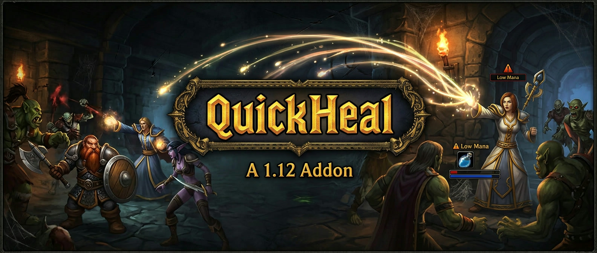

QuickHeal is a WoW Vanilla 1.12 healer helper addon designed to make raid and party healing faster and more efficient. It helps choose the appropriate healing spell for the current target, reduces overhealing, and supports class-specific healing logic for common classic healing roles.
This repository contains the addon source under the `QuickHeal/` directory and is intended for use with the classic addon ecosystem.

#Overview
QuickHeal is focused on helping healers make smarter decisions in high-pressure raid situations. It is designed for party and raid healing and includes logic to:
prioritize the most injured targets
reduce overhealing using incoming heal data
choose spell ranks more efficiently
adapt behavior based on class and healing mode
support macros and keybind-driven healing
The project includes addon logic for the following classes:
- Priest
- Paladin
- Druid
- Shaman

#Features
HealComm/Luna Unit Frames integration to account for incoming heals
Smart target prioritization based on missing health
Class-specific healing behavior
Downranking support to conserve mana
Multiple healing modes for different playstyles
Localization support for multiple languages
Integration with the classic WoW UI and addon environment
Requirements
QuickHeal is designed for World of Warcraft Vanilla 1.12 and works best alongside:
HealComm or Luna Unit Frames
BonusScanner (recommended for more accurate healing calculations)
A WoW 1.12-era client or compatible addon environment

#Installation
Download or clone this repository.
Copy the `QuickHeal/` folder into your World of Warcraft `Interface/AddOns` directory.
Ensure the addon folder is named exactly `QuickHeal` (remove any suffixes such as `-master`).
Install any required dependencies such as HealComm or Luna Unit Frames.
Reload the UI and enable the addon in-game.
Example layout:
```text
World of Warcraft/
  Interface/
    AddOns/
      QuickHeal/
        QuickHeal.toc
        QuickHeal.lua
        QuickHeal.xml
        QuickHealPriest.lua
        QuickHealPaladin.lua
        QuickHealDruid.lua
        QuickHealShaman.lua
        ...
```
#Usage
QuickHeal is controlled mainly through slash commands and macros.
Common commands:
`/qh` — trigger the main healing action
`/qh help` — display help text
`/qh dr` or `/qh downrank` — open the downrank window
`/qh hm 1` — set healing mode 1
`/qh hm 2` — set healing mode 2
`/qh hm 3` — set healing mode 3
You can also bind the addon to keys or create macros for faster in-game use.

#Healing Modes
QuickHeal includes multiple healing modes to adapt how it chooses spells:
Mode 1: default/conservative behavior
Mode 2: more focused spell selection
Mode 3: highest HPS / more aggressive spell choice
Behavior differs by class:
Priest: may use different spell ranks or cast group heals depending on mode
Paladin: may prefer spells such as Flash of Light or Holy Light
Druid and Shaman: include class-specific restorative logic

#Repository Layout
```text
.
├── QuickHeal/
│   ├── README.md
│   ├── QuickHeal.lua
│   ├── QuickHeal.xml
│   ├── QuickHealPriest.lua
│   ├── QuickHealPaladin.lua
│   ├── QuickHealDruid.lua
│   ├── QuickHealShaman.lua
│   ├── QuickClick.lua
│   ├── Bindings.xml
│   ├── HealingBar.xml
│   ├── localization.en.lua
│   ├── localization.de.lua
│   ├── localization.fr.lua
│   ├── QH.jpg
│   └── libs/
│       ├── AceAddon-2.0/
│       ├── AceConsole-2.0/
│       ├── AceEvent-2.0/
│       ├── HealComm-1.0/
│       └── RosterLib-2.0/
├── LICENSE
└── README.md
```
Note: this repository does not currently appear to include a dedicated license file at the root. If a license is required for redistribution or reuse, it should be added explicitly.
Credits
This project is based on the original QuickHeal concept and was adapted for smarter HealComm-aware healing behavior. The addon also incorporates supporting libraries such as:
AceAddon
AceConsole
AceEvent
HealComm
RosterLib
Notes
QuickHeal is a classic-era addon intended specifically for the WoW 1.12 addon ecosystem. It is best suited for players using a Vanilla-era healing setup and companion addons such as HealComm or Luna Unit Frames.
Contributing
This repository appears to be a personal or community addon project. Improvements, fixes, and compatibility updates are welcome through pull requests or direct code changes.
